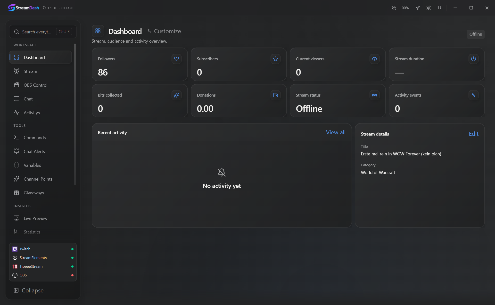
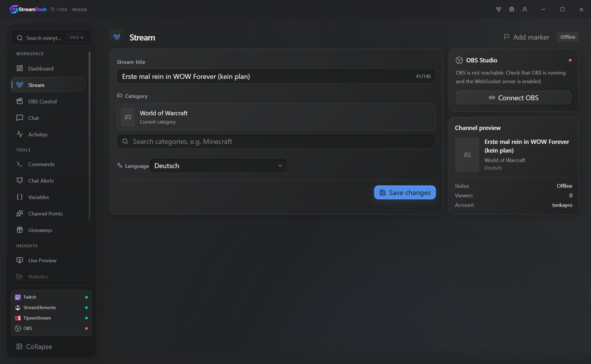
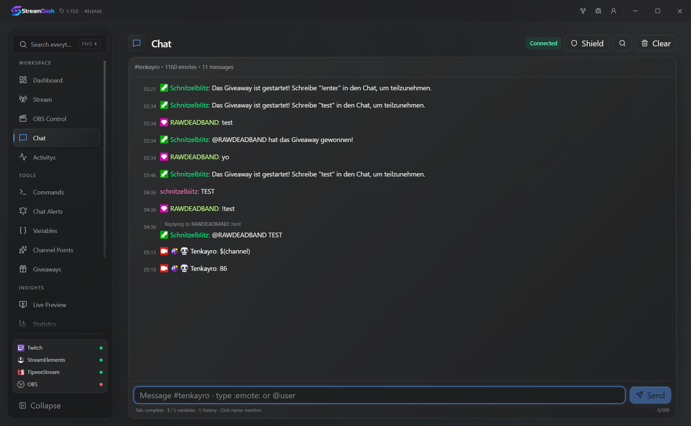
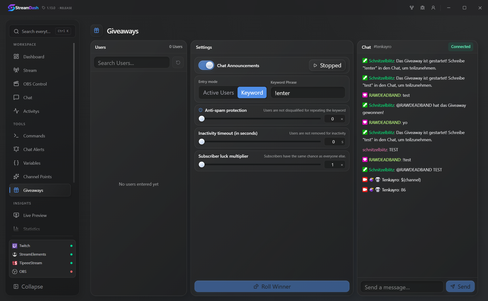
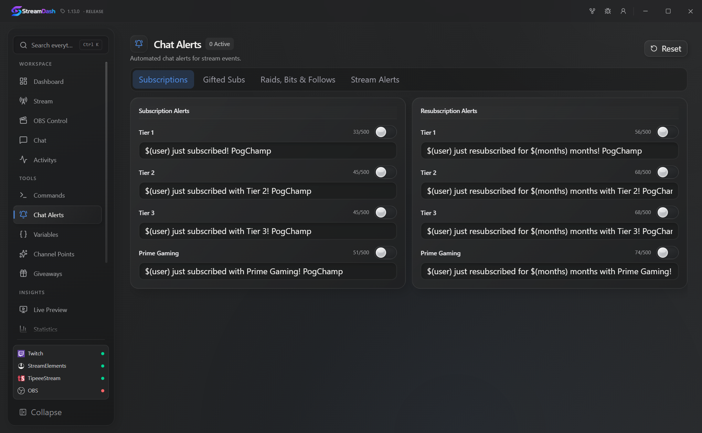
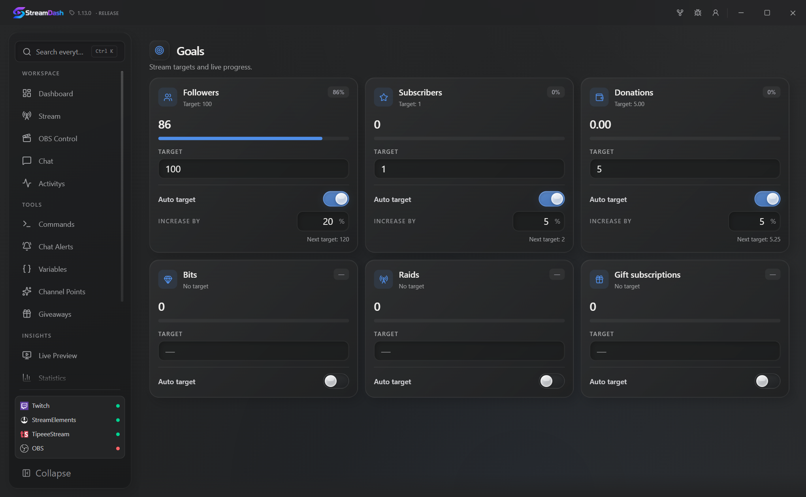

<div align="center">


### Your stream. One clean desktop workspace.

A fast, lightweight **Windows, macOS & Linux** desktop app (with a native **Android** companion) for managing, automating, and monitoring your Twitch stream in real time — without juggling a dozen browser tabs.

**Available in 5 languages:** English · Deutsch · Español · Français · Português (Brasil)

[](https://github.com/Tenkayro/StreamDash/actions/workflows/release.yml)

</div>

---

## ✨ Why StreamDash?

**StreamDash** brings everything you need while live into a single, distraction-free desktop experience: customizable widgets, live chat, moderation, OBS controls, giveaways, chat commands, alerts, StreamElements donations, and profile backups.

Keep your focus on your stream — StreamDash handles the rest quietly in the background.

---

## 🚀 Core Features

### 📊 Live Dashboard & Preview
- **Modular Widget Grid** — view followers, subscribers, viewers, bits, donations, goals, and stream status at a glance
- **Browser Sources & Live Preview** — monitor your stream output and embed custom browser panels right inside the dashboard
- **OBS Studio & Spotify Integration** — control OBS scenes, sources, and recording, and display now-playing tracks (including `!song` chat replies)

### 💬 Chat, Bot & Community Tools
- **Real-Time Twitch Chat** — badges, custom colors, emotes, timestamps, and optional dedicated Twitch Bot account support
- **Quick Moderation** — inspect viewer profiles, timeout, ban, and manage moderators directly from chat
- **Custom Commands, Variables & Chat Alerts** — build dynamic replies using central variables/counters and automated announcements
- **Giveaways & Channel Points** — run live chat giveaways with tracked entries and winners, and manage channel point rewards

### 🎬 Stream Control & Analytics
- **Stream Management** — update your stream title, game/category, and add stream markers instantly (even offline)
- **Live Activity & StreamElements** — track follows, subs, raids, cheers, redemptions, and StreamElements donations in one feed
- **Statistics & Goals** — review historical activity charts and track live follower, sub, or donation milestones
- **Native Windows Notifications & System Tray** — stay informed cleanly without cluttering your screen

### 💾 Profiles & Local Backups
- **Multi-Profile Support** — create separate layouts and configurations for different games, events, or Twitch accounts
- **Auto-Switch per Twitch Account** — automatically switch to the matching profile when changing channels
- **Selective JSON Import & Export** — back up or share appearance, dashboard layout, chat/OBS settings, or automation rules anytime

---

## 👑 StreamDash Pro

Want your setup available anywhere without manual file transfers? **StreamDash Pro** is a **one-time purchase** — no recurring subscription.

- ☁️ **Automatic Cloud Profile Sync** — securely sync your profiles, widgets, commands, and settings across setups
- 🔐 **Privacy-First by Design** — OAuth tokens, passwords, and API secrets stay strictly local on your PC and are never uploaded
- 🔄 **Smart Conflict Resolution** — choose whether to keep local changes, restore from the cloud, or merge profiles
- 🔗 **Twitch-Bound License** — tied cleanly to your Twitch account (with in-app support for one-time key resets if you linked the wrong account)
- ✨ **Future Pro Perks Included** — unlocks upcoming Pro features automatically

👉 **[Get StreamDash Pro](https://store.tenkayro.de/b/siOJA)** *(one-time payment via PayPal or card — activate directly inside **Settings → Pro & Cloud**)*

---

## 📦 Download & Install

### Windows (10 & 11 · x64)
- **Installer (Recommended):** Download [`StreamDash-Setup.msi`](https://github.com/Tenkayro/StreamDash/releases/latest/download/StreamDash-Setup.msi) and run it (includes signed built-in auto-updates)
- **Microsoft Store:** Available on the [Microsoft Store](https://apps.microsoft.com/detail/9P8MCZJVPTDQ)

### macOS (Apple Silicon & Intel)
1. Download the Universal **`.dmg`** from [GitHub Releases](https://github.com/Tenkayro/StreamDash/releases/latest)
2. Open the `.dmg` and drag **StreamDash** into **Applications**
3. *First launch (unsigned build):* Right-click **StreamDash** → **Open** (built-in updates are signed and work automatically afterwards)

### Linux (x64)
- **Recommended (Auto-Installer):** Automatically detects your distro (`.deb`, `.rpm`, `.AppImage`, or raw `.tar.gz` binary), sets up desktop integration, and includes an interactive install / update / uninstall menu:

```bash
curl -fsSL https://raw.githubusercontent.com/Tenkayro/StreamDash/main/install.sh | bash
```

- **Manual Packages** *(from [GitHub Releases](https://github.com/Tenkayro/StreamDash/releases/latest))*:
  - **Raw Binary Archive (`StreamDash-linux-x86_64.tar.gz`)** *(Universal / Headless Server — no AppImage/FUSE or package manager needed)*:
    `tar -xzf StreamDash-linux-x86_64.tar.gz && chmod +x streamdash && ./streamdash`
  - **AppImage** (Universal · built-in updater via `install.sh`): `chmod +x StreamDash_*.AppImage && ./StreamDash_*.AppImage`
  - **Debian / Ubuntu / Mint (`.deb`)**: `sudo apt install ./StreamDash_*.deb`
  - **Fedora / RHEL / openSUSE (`.rpm`)**: `sudo dnf install ./StreamDash-*.rpm` *(or `sudo zypper install ./StreamDash-*.rpm`)*

### Android (Companion App · Android 8.0+)
- **APK:** Download [`StreamDash-Android.apk`](https://github.com/Tenkayro/StreamDash/releases/latest/download/StreamDash-Android.apk) *(or the versioned `StreamDash_*_android.apk` from [GitHub Releases](https://github.com/Tenkayro/StreamDash/releases/latest))*
- Connects to StreamDash Desktop **Host Mode** on your local network via QR code scan or manual host URL + PIN, and includes signed built-in updates via GitHub Releases.

---

## 🌐 Web & Mobile Host / Headless Mode

StreamDash can host its full UI over your local network so you can control your stream from a phone, tablet, or any browser — or run invisibly in the background on a server.

- Open **Host** in the sidebar to enable the Web Host, scan the generated **QR code** (from a mobile browser or the **StreamDash Android Companion** app), copy the LAN URL, or configure the port and access token/PIN.
- Live state syncs in real time and actions (chat, OBS scenes/audio/stream/recording, giveaways) execute on the host instance.

### CLI Startup Flags

```bash
# Start invisibly without a desktop window and automatically enable the Web Host
streamdash --headless

# Start with custom port and fixed access token/PIN
streamdash --headless --port 48950 --pin MYSECRET

# Start normally with desktop window + Web Host enabled
streamdash --host

# On a display-less Linux server (no X11/Wayland session)
xvfb-run -a streamdash --headless --port 48950
```

| Flag | Description |
| :--- | :--- |
| `--headless` | Keeps the desktop window hidden and starts the Web Host automatically |
| `--host` / `--web-host` | Enables the Web Host on startup while showing the desktop window |
| `--port <PORT>` | Overrides the Web Host port (default: `48950`) |
| `--pin <TOKEN>` / `--token <TOKEN>` | Sets a custom access token/PIN |

---

## 📸 Preview

### Dashboard



### Stream Management



### Live Chat



### Giveaways



### Chat Alerts



### Goals & Progress Tracking



---

<div align="center">

**Built for streamers who want everything in one place.**

Windows · macOS · Linux · Android

</div>
